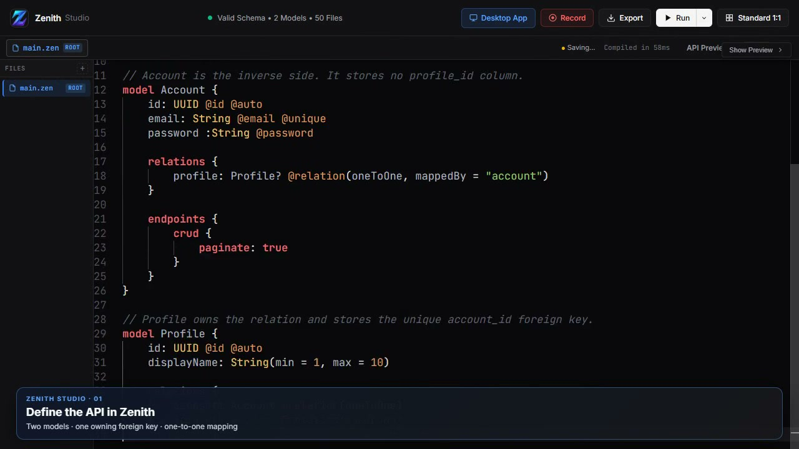

<p align="center">
  
</p>

# Zenith DSL

> **A modern, concise language on top of Java that eliminates Spring Boot boilerplate.**

[](https://www.youtube.com/watch?v=2znqx9ANIKc)

Zenith is a domain-specific language (DSL) for building Spring Boot APIs. Define models, relations, validation, and endpoints in `.zen` files. Zenith generates a standard Spring Boot 3 and Java 17 application.

## Quick Start

Validate and generate the included one-to-one example:

```cmd
.\bin\zenith.bat validate zenith-exemples\one-to-one\main.zen
.\bin\zenith.bat build zenith-exemples\one-to-one\main.zen -o generated\one-to-one
cd generated\one-to-one
mvn spring-boot:run
```

Useful links:

- [Language and Studio reference](docs/index.html)
- [One-to-one relation example](zenith-exemples/one-to-one/main.zen)
- [TaskFlow example](zenith-exemples/taskflow/main.zen)
- [CLI commands](#cli-commands--dx-phase-4)

## Demo

### One-to-one API in Zenith Studio

Watch a narrated 16:9 walkthrough of the one-to-one example. It covers the schema, ERD, generated Java repository tree, Spring Boot startup, and live Account and Profile CRUD requests. See the [example schema](zenith-exemples/one-to-one/main.zen).

[](docs/assets/one-to-one-studio-demo.mp4)

[Watch or download the MP4](docs/assets/one-to-one-studio-demo.mp4) · [English captions](docs/assets/one-to-one-studio-demo.en.vtt)

## Contents

- [Overview](#the-zenith-solution)
- [Quick start](#quick-start)
- [Demo](#demo)
- [CLI and Studio](#cli-commands--dx-phase-4)
- [Language features](#enterprise-features-phase-2--3)
- [Generated project and testing](#testing-the-generated-project)
- [Contributing](#contributing)

---

## The Problem: Java's 9-File Ceremony

To expose a standard CRUD endpoint with validation, pagination, and relationships in idiomatic Spring Boot, Java requires:

```
src/main/java/com/example/store/
├── entity/Product.java                     (~60 lines: @Entity, @Table, @Id, @Column, getters/setters)
├── dto/CreateProductRequest.java           (~30 lines: Java record with @NotBlank, @Positive, etc.)
├── dto/UpdateProductRequest.java           (~25 lines: Java record)
├── dto/ProductResponse.java                (~25 lines: Java record)
├── mapper/ProductMapper.java               (~40 lines: mapping DTOs <-> Entities)
├── repository/ProductRepository.java       (~20 lines: @Repository, JpaRepository, custom queries)
├── service/ProductService.java             (~15 lines: Service interface)
├── service/impl/ProductServiceImpl.java    (~70 lines: @Service, @Transactional, paging, search)
└── controller/ProductController.java       (~60 lines: @RestController, @GetMapping, @PostMapping...)
```

**Total:** **9 files, ~350 lines of boilerplate** per resource!

---

## The Zenith Solution

With Zenith, the exact same resource is expressed in **18 lines of clean, readable code**:

```zen
model Product {
    id: Long @id @auto
    sku: String(length = 32) @unique
    name: String(min = 3, max = 150)
    description: String? @text
    price: Decimal(precision = 12, scale = 2) @positive
    stock: Int @min(0) = 0
    status: ProductStatus = ACTIVE
    createdAt: DateTime @autoNow
    updatedAt: DateTime @autoUpdate

    relations {
        category: Category @relation(manyToOne)
    }

    endpoints {
        crud {
            paginate: true
            search: [name, sku]
            filter: [status]
            sort: [price, createdAt]
        }

        post "/{id}/archive" -> ProductResponse {
            description: "Archives a product"
            guard: status != ProductStatus.ARCHIVED, "Product is already archived"
            action: {
                status = ProductStatus.ARCHIVED,
                stock = 0
            }
        }
    }
}
```

---

## Who Is This Solution For?

Zenith was built to address a fundamental tension in backend engineering: **Java and Spring Boot provide exceptional runtime performance, stability, and enterprise tooling, but the ceremony required to write and maintain standard REST APIs is exhausting.**

If your daily workflow touches any of the following scenarios, Zenith was built for you:

### 1. Spring Boot Developers & Backend Teams Facing Boilerplate Fatigue

You work with Java and Spring Boot every day. You appreciate strong typing, JPA, and Spring Security, but you dread adding new domain entities because each one requires manually creating and wiring:

- The JPA `@Entity` with column definitions, table mappings, and validation constraints
- 3 to 4 Java `record` DTOs (`CreateRequest`, `UpdateRequest`, `Response`)
- A mapper class or MapStruct interface to synchronize DTOs and entities
- A `JpaRepository` with custom query methods
- A `Service` interface and its `@Transactional` implementation
- A `@RestController` with repetitive `@GetMapping`, `@PostMapping`, and Swagger annotations
- A Flyway migration file with matching DDL

Zenith consolidates all of that into a single `.zen` domain definition. You define the schema, validation rules, relationships, and endpoint behavior once; Zenith transpiles it into standard, clean, idiomatic Spring Boot 3 code in milliseconds.

### 2. Full-Stack Engineers & Solo Builders

You want to deliver production-ready applications end-to-end without spending days configuring infrastructure plumbing before writing your first business feature:

- **Instant Backend**: Get JWT authentication, role-based access control, OpenAPI documentation, S3/MinIO file uploads, and background cron jobs out of the box.
- **Typed Frontend Integration**: Zenith generates a matching TypeScript SDK with strict interface definitions, a zero-dependency Fetch client, and pre-wired React Query hooks (`@tanstack/react-query`) synchronized with your backend models.
- **Container Infrastructure**: A multi-stage `Dockerfile` and `docker-compose.yml` are generated automatically for local testing and cloud deployment.

### 3. Startups, Agencies, and Fast-Moving Product Teams

Startups often choose dynamic stacks (Rails, Django, Node.js) for initial prototyping speed, only to face performance and refactoring hurdles as the codebase matures. Conversely, starting directly with raw Java can slow down early product discovery.

Zenith provides the prototyping velocity of Rails or Prisma with the enterprise reliability and type safety of Spring Boot 3 + Java 17. You can prototype schemas visually in **Zenith Studio**, test live endpoints in the browser, export the production codebase, and deploy immediately.

### 4. Tech Leads & Architects Standardizing Microservices

When multiple engineers or squads build microservices independently, subtle architectural drift is inevitable: inconsistent pagination contracts, varied DTO naming patterns, different Spring Security configurations, and fragmented error formats.

With Zenith:

- Architecture standards are codified directly into the compiler.
- Every generated microservice shares identical architectural layering, uniform error handling, consistent Swagger documentation, and standard DTO patterns.
- **Zero Vendor Lock-In**: The output Zenith produces is standard Java 17, Spring Boot 3, and Maven. There is no custom runtime dependency or proprietary library required in production. If your team ever decides to stop using Zenith, you simply keep the generated Java source code and maintain it with IntelliJ, Eclipse, or VS Code as a standard Spring Boot repository.

---

### When Should You Not Use Zenith?

To be transparent about its scope, Zenith is intentionally optimized for REST APIs and relational domain architectures. It may not be the right choice if:

- **Your application relies heavily on legacy database stored procedures** or non-relational document/graph databases (MongoDB, Neo4j).
- **Your architecture is non-REST by design** (e.g., pure gRPC streaming, low-level binary socket protocols, or complex CQRS event-sourcing pipelines).
- **You prefer handwriting and tweaking every individual line of boilerplate manually** rather than using declarative domain modeling.

---

## Build & Installation Scripts

Zenith includes dedicated one-click automation scripts to quickly compile the CLI compiler and install the VS Code extension:

### 1. Build & Update Zenith CLI

Whenever you update the parser, lexer, AST, or generators (`src/main/java/`):

```cmd
.\build-cli.bat
```

- **What it does**: Scans all Java sources, compiles them to `target/classes`, and updates the standalone executable fat JAR `bin\zenith.jar`.
- **Important**: Close any running `zenith studio` or Java processes before running to avoid Windows file locks on `bin\zenith.jar`.

### 2. Package & Install VS Code Extension

Whenever you update syntax highlighting (`syntaxes/zenith.tmLanguage.json`), icons, or extension configurations:

```cmd
.\update-extension.bat
```

_(Or from within `zenith-vscode`: `.\update.bat`)_

- **What it does**: Packages the extension into a `.vsix` archive and immediately forces an install into your local VS Code via `code --install-extension`.
- **Apply changes**: Press `Ctrl + Shift + P` in VS Code and choose **Developer: Reload Window**.

---

## CLI Commands & DX (Phase 4)

Zenith includes self-contained launcher scripts in the `bin/` directory:

- **Windows (Command Prompt):** `.\bin\zenith.bat <command>`
- **Windows (PowerShell):** `.\bin\zenith.ps1 <command>`
- **Linux / macOS:** `./bin/zenith <command>`

### 1. `zenith watch <file.zen> [-o <out-dir>]` _(Hot Reload)_

Monitors your `.zen` file and automatically re-compiles the entire Spring Boot backend in milliseconds whenever you save:

```cmd
.\bin\zenith.bat watch zenith-exemples\taskflow\main.zen -o generated\taskflow
```

### 2. `zenith build <file.zen> [-o <output-dir>]`

Compiles your schema and generates the complete Spring Boot 3 application.

### 3. `zenith inspect <file.zen>`

Analyzes and prints all parsed models, relations, field constraints, and REST API paths.

### 4. `zenith validate <file.zen>`

Validates schema syntax, types, and foreign key references.

### 5. `zenith init [file.zen]`

Scaffolds a new starter schema file.

### 6. `zenith studio <file.zen> [--desktop] [--port 3000]` _(Zenith Studio IDE)_

Launches **Zenith Studio** — a full-featured visual architecture IDE running locally at `http://localhost:3000` or as a standalone native desktop app. Key capabilities include:

- **Monaco Code Editor**: Real-time syntax diagnostics, auto-completion, and clickable file import navigation.
- **Interactive Architecture ERD**: Live relation diagrams with field types, primary keys, foreign keys, and `1:1`, `1:N`, and `M:N` cardinalities.
- **Build Diagnostics**: Generated Java errors point to the matching schema endpoint when source mapping is available.
- **Unified Multi-Window API Tester**: Simultaneous testing of HTTP REST requests and real-time STOMP WebSocket streams side-by-side with parameter injection, schema placeholders, and dual execution (`Simulate` vs `Send`).
- **Visual Dependency Workflows (Community Feature)**: 2D interactive DAG canvas for chaining multi-step API journeys, manual pin-to-pin wiring, AST auto-wiring, declarative assertions, and animated pipeline execution.
- **Zenith Command Terminal**: A dedicated terminal in the Console panel for running Zenith CLI commands such as `zenith validate`, `zenith build`, and `zenith inspect`, alongside Maven, Git, Docker, and shell commands. It supports the workspace or generated project directory and streams output with command history.
- **Docker Compose Controls**: Use the Docker tab's **Compose Up** and **Compose Down** controls to start or stop the generated project's Docker Compose services, with container output available in Studio.
- **VPS Deployment over SSH**: Register an SSH server profile, select it in the Docker tab, then deploy the generated project or inspect logs, status, and restart services from Studio. The VPS must have SSH access and Docker Compose available.
- **Repository Tree & ZIP Export**: Emitted Java files inspection and one-click full Spring Boot ZIP export.

For example, register and check a VPS from the Zenith terminal:

```sh
zenith server add production --host <vps-ip> --user <ssh-user> --key <private-key-path>
zenith server test production
```

Then select `production` in Studio's Docker tab and choose **Deploy**. Zenith transfers the generated project and runs `docker compose up -d --build` on the server. The same tab provides remote **Logs**, **Status**, and **Restart** actions.

#### Web Mode (Default)

Opens the studio inside your default web browser at `http://localhost:3000`:

```cmd
.\bin\zenith.bat studio zenith-exemples\nexus-commerce\main.zen
```

#### Native Desktop Mode (`--desktop` or `-d`)

Launches a dedicated, frameless native desktop application window:

```cmd
.\bin\zenith.bat studio zenith-exemples\nexus-commerce\main.zen --desktop
```

### 7. `zenith mcp` _(Model Context Protocol Server for AI Agents)_

Starts the native Zenith MCP server over standard I/O (JSON-RPC 2.0). Connects Claude Code, Cursor, Antigravity, and MCP-compatible AI assistants directly to the Zenith compiler:

```cmd
.\bin\zenith.bat mcp
```

**Exposed MCP Capabilities:**

- **7 Tools**: `zenith_get_specification`, `zenith_get_examples`, `zenith_list_features`, `zenith_validate`, `zenith_explain_error`, `zenith_build`, `zenith_get_project_info`.
- **Resources**: `zenith://specification/*`, `zenith://examples/*`.
- **Prompts**: `create_crud_project`, `create_authentication_system`, `debug_zenith_project`, `extend_existing_project`.
- **Structured Diagnostics**: Machine-readable error codes (`ZEN-xxx`), exact file/line/column markers, and automated code fix suggestions.

#### Download Prebuilt Windows Desktop Installer (.exe)

You can download the standalone desktop installer directly:

- **[Download Zenith-Studio-Setup.exe](https://github.com/ouerghi0x/zenith-lang/releases/download/v1.0.0/Zenith-Studio-Setup.exe)** _(Self-contained NSIS installer, ~82 MB)_
- Includes desktop shortcut, Start Menu integration, embedded offline runtime, and uninstaller.

To build the installer locally from source at any time:

```cmd
.\desktop\build-desktop.bat
```

The executable is generated into `desktop\dist\Zenith-Studio-Setup.exe`.

---

## VS Code Extension (Phase 4)

A dedicated VS Code extension is included under `zenith-vscode/`:

- **Syntax Highlighting**: Keywords (`config`, `model`, `enum`, `guard`, `action`, `endpoints`, `crud`), HTTP methods, decorators (`@id`, `@password`, `@role`), and operators.
- **Auto-closing pairs**: Braces `{}`, brackets `[]`, and quotes.
- **Snippets**: Instant scaffolding for `config`, `model`, `enum`, and `endpoint`.

**Installation**:
Run `.\update-extension.bat` from the root directory to package and install the extension into VS Code automatically. Simply reload your window (`Ctrl+Shift+P` -> `Developer: Reload Window`) to enjoy instant `.zen` syntax highlighting!

---

## Enterprise Features (Phase 2 & 3)

### Application Configuration Reference (`config { ... }`)

Declare application-wide architecture, database dialect, authentication, and external services:

| Property        | Type         | Default             | Description                                                                                                                                                                                 |
| :-------------- | :----------- | :------------------ | :------------------------------------------------------------------------------------------------------------------------------------------------------------------------------------------ |
| `app`           | `String`     | `"ZenithApp"`       | Application name used in Maven artifact ID, OpenAPI metadata, and Docker naming.                                                                                                            |
| `package`       | `String`     | `"com.example.app"` | Base Java package for generated controllers, services, repositories, and models.                                                                                                            |
| `basePath`      | `String`     | `"/api/v1"`         | Global REST URL prefix for all generated controllers.                                                                                                                                       |
| `port`          | `Int`        | `8080`              | Embedded Tomcat server port (`server.port`).                                                                                                                                                |
| `database`      | `Identifier` | `h2`                | Target SQL dialect: `postgres`, `mysql`, or `h2`. Selecting `mysql` automatically includes `com.mysql:mysql-connector-j`, MySQLDialect, and MySQL DDL.                                      |
| `auth`          | `Identifier` | `none`              | Security mode: `jwt` or `none` (default: `none`). Spring Security 6, JJWT dependencies, JWT filters, and AuthController are strictly included only when `auth: jwt` is explicitly declared. |
| `swagger`       | `Boolean`    | `false`             | Generates OpenAPI 3.0 / Swagger UI at `/swagger-ui.html`. Disabled by default; explicitly opt-in with `swagger: true`.                                                                      |
| `flyway`        | `Boolean`    | `false`             | Generates Flyway database migration scripts (`V1__initial_schema.sql`). Disabled by default; explicitly opt-in with `flyway: true`.                                                         |
| `storage`       | `Identifier` | `minio`             | Unified object storage provider: `minio` (local S3-compatible dev storage) or `s3` (AWS S3 cloud production).                                                                               |
| `storageBucket` | `String`     | `"zenith-bucket"`   | Default bucket name for media, images, and file uploads.                                                                                                                                    |
| `proxy`         | `Identifier` | `none`              | Set to `nginx` to generate an Nginx reverse proxy and load balancer in Docker Compose.                                                                                                      |
| `replicas`      | `Int`        | `2`                 | Number of Spring Boot app containers behind Nginx (1-100; used with the proxy).                                                                                                             |
| `ssl`           | `Boolean`    | `false`             | Publishes host port `443` on the generated Nginx service. TLS certificates and an HTTPS listener are not generated yet; see below.                                                          |

```zen
config {
    app: "PulseHealth"
    package: "com.pulsehealth.app"
    basePath: "/api/v1"
    port: 8080
    database: mysql          // postgres | mysql | h2
    auth: jwt                // Explicitly enables Spring Security 6 & JWT
    swagger: true            // Opt-in OpenAPI 3.0 Swagger UI
    flyway: true             // Opt-in Flyway versioned DDL migrations
    storage: minio           // minio | s3
    storageBucket: "pulse-media"
    proxy: nginx             // Nginx reverse proxy and load balancer
    replicas: 1              // Spring Boot containers behind Nginx
    ssl: true                // publishes port 443; TLS setup is not generated yet
}
```

### Nginx Reverse Proxy & Load Balancer

Set `proxy: nginx` to generate `nginx/nginx.conf` and an Nginx service in `docker-compose.yml`. Zenith creates the number of Spring Boot app containers set by `replicas` and configures Nginx to distribute requests across them with `least_conn`. The app containers stay on the Compose network; Nginx publishes HTTP on port 80. The generated upstream currently targets container port 8080; keep `port: 8080` or update `nginx/nginx.conf` if you change it. Start the stack with `docker compose up --build` and send requests through `http://localhost`.

`ssl: true` currently adds a `443:443` port mapping to the Nginx service. **It does not configure HTTPS yet:** generated Nginx config only listens on port 80 and does not create or mount certificates. Configure a certificate and TLS server block yourself before serving HTTPS, or terminate TLS at an external load balancer and forward HTTP to Nginx.

### 1. Spring Security 6 & JWT Authentication

When `auth: jwt` is declared in `config`, Zenith integrates Spring Security 6 and generates complete token-based authentication. Designate a model with `@password` and `@role`:

```zen
enum UserRole {
    ADMIN,
    DOCTOR,
    PATIENT
}

model Customer {
    id: Long @id @auto
    email: String @unique @email
    password: String @password                   // Automatically applies @NotBlank & @Size(min=8, max=100) to Create DTO
    role: UserRole = PATIENT @role               // Canonical default role assigned on registration
}
```

Zenith generates:

- `SecurityConfig.java`: Stateless session management, CORS configuration, CSRF disabled, and BCrypt password encoder.
- `JwtService.java` & `JwtAuthenticationFilter.java`: Bearer token extraction and validation.
- `AuthController.java`: `POST /api/v1/auth/login` and `POST /api/v1/auth/register` (new registrations automatically receive the designated default role).
- **DTO Validation Propagation**: `@password` automatically applies `@NotBlank` and `@Size(min = 8, max = 100)` on the `CreateCustomerRequest` DTO; `@email`, `@positive`, `@min`, `@max`, and string lengths propagate to both JPA entities and request DTOs.
- Passwords are automatically hashed with BCrypt and excluded from all API response DTOs (`@JsonIgnore`).

### 2. Interactive Swagger UI / OpenAPI 3 (Opt-In)

- Enable with `swagger: true` in `config`. If omitted or set to `false`, OpenAPI dependencies and Swagger annotations are completely excluded from the generated project.
- Interactive Swagger UI available at: `http://localhost:8080/swagger-ui.html`.
- `@Tag` and `@Operation` auto-documented on all endpoints.

### 3. Flyway Database Migrations & Declarative Indexes (`@index`, `@uniqueIndex`)

- Enable with `flyway: true` in `config`. If omitted or set to `false`, Flyway dependencies and migration files are not generated.
- Generates `src/main/resources/db/migration/V1__initial_schema.sql` with exact DDL, foreign keys, and indexes for PostgreSQL, MySQL, or H2.
- **Single-Column & Composite Indexes**: Annotate individual fields with `@index` / `@uniqueIndex`, or declare model-level composite indexes (`@index([customer, status])`, `@index([status, createdAt], name = "idx_custom")`, `@uniqueIndex([orderNumber, customer])`). Zenith emits matching `CREATE [UNIQUE] INDEX` statements in Flyway DDL and `@Table(indexes = { @Index(...) })` on JPA entities, with automatic 63-character identifier truncation and reserved keyword quoting.

```zen
model Order {
    id: UUID @id @auto
    orderNumber: String(length = 32) @unique
    status: OrderStatus = PENDING @index             // Inline single-column index
    createdAt: DateTime @autoNow

    relations {
        customer: Customer @relation(manyToOne)
    }

    @index([customer, status])                       // Composite index (customer_id, status)
    @index([status, createdAt], name = "idx_orders_timeline")
    @uniqueIndex([orderNumber, customer])            // Composite unique index
}
```

> **💡 Placement Tip**: Place model-level composite indexes (`@index([...])` / `@uniqueIndex([...])`) **below the `relations { ... }` block** (and above `endpoints { ... }`). Because composite indexes often reference foreign-key relations (such as `customer` -> `customer_id`), declaring them after `relations` keeps all referenced columns defined above the index and separates model-level indexes from inline field decorators.

### 4. Declarative API Rate Limiting (`@rateLimit` & Token Bucket)

Protect public registration, login, checkout, and webhook endpoints against automated abuse, brute-force attacks, and resource exhaustion. Zenith generates a Spring Security filter powered by the **Bucket4j** token bucket algorithm, emitting standard RFC rate-limiting headers: `X-Rate-Limit-Limit`, `X-Rate-Limit-Remaining`, `X-Rate-Limit-Reset`, and `Retry-After` with **HTTP 429 Too Many Requests**.

- **Endpoint-Level Limits**: Decorate any route with `@rateLimit("10/minute")`, `@rateLimit(requests = 50, per = "1m")`, or in the route body with `rateLimit: "5/second"`.
- **Model CRUD Limits**: Throttle an entire CRUD resource with `crud { rateLimit: "100/minute" }`.
- **Global Fallback Limit**: Set a default baseline in `config { rateLimit: "500/minute" }`.
- **Client Identity Strategy**: Authenticated users are keyed by username/ID (`user:<id>`); anonymous traffic is keyed by IP address with automatic reverse proxy header extraction (`X-Forwarded-For`, `X-Real-IP`).
- **Interactive Burst Testing**: Zenith Studio's API Tester includes a **Burst Test ⚡ (x10)** tool that sends rapid requests in sequence to visualize real-time throttling, header responses, and quota exhaustion.

```zen
config {
    app: "ShopSphere"
    package: "com.shopsphere.backend"
    rateLimit: "500/minute"               // Global default fallback
}

model Order {
    id: UUID @id @auto
    totalAmount: Decimal(12, 2)
    status: OrderStatus = PENDING

    endpoints {
        crud {
            rateLimit: "100/minute"      // Rate limit standard CRUD routes
        }

        // Decorator syntax on custom endpoints
        @rateLimit(requests = 5, per = "1m")
        post "/checkout" -> OrderResponse {
            action: {
                status = OrderStatus.PAID
            }
        }

        // Inline route body syntax
        post "/{id}/pay" -> Void {
            rateLimit: "10/minute"
            action: {
                status = OrderStatus.PAID
            }
        }
    }
}
```

### 5. API Security & Role-Based Access Control (RBAC)

Zenith integrates with Spring Security 6 to generate method-level `@PreAuthorize` security checks across standard CRUD and custom endpoints.

#### Default Security Convention

- **Read operations** (`GET /`, `GET /{id}`): Public (`@PreAuthorize("permitAll()")`).
- **Write operations** (`POST`, `PUT`, `DELETE`): Authenticated (`@PreAuthorize("isAuthenticated()")`).

#### CRUD Security Options

```zen
model Product {
    endpoints {
        // Option A: Open public CRUD (no token needed)
        crud { public: true }

        // Option B: Full authenticated CRUD (Bearer JWT required for all)
        crud { auth: true }

        // Option C: Global role restriction (requires ADMIN or MANAGER)
        crud { roles: [ADMIN, MANAGER] }

        // Option D: Granular per-operation RBAC
        crud {
            list: public              // Anyone can browse catalog
            get: public               // Anyone can view details
            create: [ADMIN, EDITOR]   // Editors & Admins can create
            update: [ADMIN, EDITOR]   // Editors & Admins can update
            delete: [ADMIN]           // Only Admins can delete
        }
    }
}
```

#### Custom Endpoint Security Options

```zen
// 1. Explicitly Public Route
get "/catalog/featured" -> List<ProductResponse> {
    public: true                      // @PreAuthorize("permitAll()")
}

// 2. Authenticated-Only Route
post "/{id}/rate" -> Void {
    auth: true                        // @PreAuthorize("isAuthenticated()")
}

// 3. Multi-Role Restriction
post "/{id}/archive" -> ProductResponse {
    auth: [ADMIN, MANAGER]            // @PreAuthorize("hasAnyRole('ADMIN', 'MANAGER')")
}

// 4. Custom DTO Return Route with Action Logic & Auto-Mapping
post "/{id}/pay" -> OrderSummaryResponse {
    auth: true
    guard: status == OrderStatus.PENDING, "Only pending orders can be marked as paid"
    action: {
        status = OrderStatus.PAID
        create AuditLog {
            action = "ORDER_PAYMENT_PROCESSED",
            details = "Order " + entity.orderNumber + " marked PAID by " + currentUser.email
        }
        notify(entity.customer.email, "Your payment for order " + entity.orderNumber + " succeeded!")
    }
}

// 5. Declarative Role Guard + Domain Business Rule
post "/{id}/publish" -> ProductResponse {
    guard: role in [ADMIN, PUBLISHER], "Must be a publisher or admin"
    guard: status == ProductStatus.DRAFT, "Only draft products can be published"
    action: {
        status = ProductStatus.PUBLISHED
    }
}

// 6. User-Scoped Route (Filters automatically for currentUser)
get "/my-products" -> List<ProductResponse> {
    user: true
}
```

### 6. Declarative Logic & Domain Actions

Use actions for entity updates, related-record creation, notifications, guards, and date calculations. Bind created or updated records with `var` so later statements can use their generated IDs and values. For a non-void endpoint that creates its own model, Zenith maps the new record to the declared response DTO unless the action returns a value explicitly.

```zen
post "/{id}/complete" -> Void {
    auth: true
    guard: status == TaskStatus.IN_PROGRESS, "Task must be in progress to complete"
    action: {
        // 1. Mutate primary entity
        status = TaskStatus.DONE
        completedAt = now()

        // 2. Action variable binding: capture created audit record & propagate
        var log = create AuditLog {
            action = "TASK_COMPLETED",
            details = "Task " + entity.title + " completed by " + currentUser.email,
            retentionUntil = daysFromNow(90)
        }

        // 3. Update secondary related model (Parent Project) referencing log metadata
        update Project {
            where: id == entity.project.id
            completedTasks = entity.project.completedTasks + 1
            status = ProjectStatus.ACTIVE
            lastActivityAt = now()
        }

        // 4. Notification hook
        notify(entity.project.owner, "Task completed: " + entity.title)
    }
}
```

#### Loop over a list

Inside an endpoint action, `for item : listExpression { ... }` runs the body once per list item, in order. The loop variable is available inside the loop body. This example creates one audit row for every ID in the request:

```zen
dto BulkUserIdsRequest {
    ids: List<UUID>
}

model User {
    id: UUID @id @auto
    endpoints {
        post "/bulk-audit" (body: BulkUserIdsRequest) -> Void {
            action: {
                for userId : body.ids {
                    var audit = create AuditEntry {
                        userId = userId
                        action = "BULK_PROCESSED"
                    }
                }
            }
        }
    }
}

model AuditEntry {
    id: UUID @id @auto
    userId: UUID
    action: String
}
```

#### Strict Compile-Time Analysis & Error Prevention

Zenith enforces strict static analysis across all action and job blocks:

- **Zero Silent Failures**: Any unrecognized method, unsupported statement, or misspelled property (e.g. updating a field that does not exist on the target model) immediately triggers a clear, descriptive compilation error.
- **Valid Java Guarantee**: Unsupported logic is caught during the analysis phase, ensuring the compiler never produces invalid or broken Java output.

### 7. File Uploads & Media Storage (`@file`, `@image`)

Provider-independent object storage abstraction supporting **MinIO** for local development and **AWS S3** for production cloud deployments with zero code changes:

```zen
config {
    storage: minio               // minio (local dev) | s3 (cloud)
    storageBucket: "media-bucket"
}

model Customer {
    id: UUID @id @auto
    email: String @email @unique
    // Validated image uploads with MIME constraint
    avatar: String? @image(maxSize = "5MB", types = ["image/jpeg", "image/png"], path = "avatars/")
    // Document upload with size constraint
    resume: String? @file(maxSize = "20MB", types = ["application/pdf"], path = "resumes/")
}
```

- **Generic REST API**: `POST /api/v1/files/upload`, `GET /api/v1/files/{fileKey}`, `DELETE /api/v1/files/{fileKey}`.
- **Entity-Bound Endpoints**: `POST /api/v1/customers/{id}/avatar`, `GET ...`, `DELETE ...` (generated only when `endpoints` and `crud` exist on the model).
- **Zero-code cloud migration**: Switch between local MinIO and AWS S3 via environment variables (`STORAGE_PROVIDER=s3`, `AWS_REGION`, etc.).

### 8. Declarative Database Seeding

Populate dev and staging environments with deterministic seed data and foreign key cross-referencing:

```zen
seed UserEntity {
    [
        { email: "admin@app.io", role: ADMIN, fullName: "Admin", password: "password123" }
    ]
}

seed Task {
    [
        {
            title: "Configure CI/CD",
            status: TODO,
            assignee: seed UserEntity[0]     // Cross-references the 1st UserEntity
        }
    ]
}
```

### 9. Modular Multi-File Schemas (`import`)

Decompose enterprise architectures into modular `.zen` domain files:

```zen
// schema.zen (Entry schema)
config {
    app: "EnterpriseCRM"
    database: postgres
    auth: jwt
    storage: minio
}

import "./auth.zen"       // UserEntity & Role
import "./customers.zen"  // Customer & Address
import "./orders.zen"     // Order & OrderItems
```

### One-to-One Relations

Declare the owning relation without `mappedBy`. Put `mappedBy` on the inverse relation. Zenith generates one unique foreign key on the owning side; the inverse side does not get a second column.

```zen
model Account {
    id: UUID @id @auto
    relations {
        profile: Profile? @relation(oneToOne, mappedBy = "account")
    }
}

model Profile {
    id: UUID @id @auto
    relations {
        account: Account @relation(oneToOne)
    }
}
```

See the complete [one-to-one example](zenith-exemples/one-to-one/main.zen), including endpoints and Flyway configuration.

### 10. Custom Data Transfer Objects (DTO) & Endpoint Auto-Mapping

Define custom request and response payloads decoupled from JPA database models with strict typing and optionality:

```zen
dto AssignTaskRequest {
    assigneeId: UUID
    comment: String?
}

dto OrderSummaryResponse {
    id: UUID
    orderNumber: String
    totalAmount: Decimal
    status: OrderStatus
    customerId: UUID?       // Automatically mapped from entity.customer.id
}
```

#### Custom DTO Return Types on Endpoints & Auto-Mapping Example

When an endpoint declares a custom DTO return type (e.g. `post "/{id}/pay" -> OrderSummaryResponse` or `get "/summaries" -> List<OrderSummaryResponse>`), Zenith provides two flexible paradigms:

##### Option A: Explicit `return DTO { ... }` in the Action Block

Allow explicit DTO return construction inside the `action` block for full control over computed fields, aggregations, and authenticated user context:

```zen
post "/{id}/pay" -> OrderSummaryResponse {
    auth: true
    guard: status == OrderStatus.PENDING, "Only pending orders can be marked as paid"
    action: {
        status = OrderStatus.PAID
        return OrderSummaryResponse {
            orderNumber = entity.orderNumber,
            totalAmount = entity.totalAmount,
            itemCount = entity.items.size(),
            processedBy = currentUser.email
        }
    }
}
```

Transpiles directly to explicit record instantiation in the service layer:

```java
entity.setStatus(OrderStatus.PAID);
entity = orderRepository.save(entity);

return new OrderSummaryResponse(
    entity.getOrderNumber(),
    entity.getTotalAmount(),
    entity.getItems().size(),
    currentUsername
);
```

##### Option B: Automatic Coincident Field & Relation Mapping (Zero-Boilerplate)

When no explicit return statement is written in the action block, Zenith automatically compares the target DTO with the model and generates a dedicated mapper method:

- **Coincident Field Matching**: Attributes with matching names and compatible types (`id`, `orderNumber`, `totalAmount`, `status`) are copied directly from the entity.
- **Relational Foreign Key Resolution**: If a DTO property is named `{relation}Id` (e.g. `customerId: UUID`) and the entity declares a relation named `customer`, Zenith extracts the ID safely (`entity.getCustomer() != null ? entity.getCustomer().getId() : null`).
- **Unmatched / Computed Fields**: Attributes not present in the model receive safe typed defaults (`0`, `""`, `null`) or explicit query expressions.
- **Service & Controller Generation**: Service implementations invoke `orderMapper.toOrderSummaryResponse(entity)` and controllers return `ResponseEntity<OrderSummaryResponse>`.

```zen
dto OrderSummaryResponse {
    id: UUID
    orderNumber: String
    totalAmount: Decimal
    status: OrderStatus
    customerId: UUID?       // Automatically mapped from entity.customer.id
    receiptUrl: String?     // Unmatched field: receives default (null)
}

model Order {
    id: UUID @id @auto
    orderNumber: String(length = 20) @unique
    totalAmount: Decimal(precision = 12, scale = 2)
    status: OrderStatus = PENDING

    relations {
        customer: Customer @relation(manyToOne)
    }

    endpoints {
        // Custom endpoint returning OrderSummaryResponse
        post "/{id}/pay" -> OrderSummaryResponse {
            auth: true
            guard: status == OrderStatus.PENDING, "Only pending orders can be marked as paid"
            action: {
                status = OrderStatus.PAID
                notify(entity.customer.email, "Your payment for order " + entity.orderNumber + " succeeded!")
            }
        }
    }
}
```

Transpiles to auto-generated mapper and service invocation:

```java
@Component
public class OrderMapper {
    public OrderSummaryResponse toOrderSummaryResponse(Order entity) {
        if (entity == null) {
            return null;
        }
        return new OrderSummaryResponse(
            entity.getId(),                                                       // Direct field match
            entity.getOrderNumber(),                                              // Direct field match
            entity.getTotalAmount(),                                              // Direct field match
            entity.getStatus(),                                                   // Direct field match
            entity.getCustomer() != null ? entity.getCustomer().getId() : null,  // Relational FK resolved
            null                                                                  // Safe default for unmatched field
        );
    }
}
```

### 11. Background Workers & Scheduled Jobs (`job`, `@cron`)

Define production-grade scheduled maintenance routines, cleanup jobs, and batch queues:

```zen
job ArchiveOldTasks {
    cron: "0 0 2 * * ?"
    description: "Nightly maintenance archiving tasks completed over 30 days ago"
    action: {
        update Task {
            where: status == DONE and updatedAt < daysAgo(30)
            status = ARCHIVED
        }
    }
}
```

Zenith generates a `@Component` job with `@EnableScheduling`, `@EnableAsync`, `ThreadPoolTaskScheduler`, and transactional bulk streaming queries.

#### Logic Transpiler: Time Expressions & Bulk Stream Filters

The Zenith transpiler automatically converts high-level temporal functions and bulk criteria into type-safe, null-safe Spring Boot 3 stream filters and repository batch updates:

- **Time Expressions**:
  - `now()` &rarr; `java.time.LocalDateTime.now()`
  - `today()` &rarr; `java.time.LocalDate.now()`
  - `daysFromNow(n)` or `n.daysFromNow` &rarr; `java.time.LocalDateTime.now().plusDays(n)`
  - `hoursFromNow(n)` &rarr; `java.time.LocalDateTime.now().plusHours(n)`
  - `minutesFromNow(n)` &rarr; `java.time.LocalDateTime.now().plusMinutes(n)`
  - `monthsFromNow(n)` / `yearsFromNow(n)` &rarr; `java.time.LocalDateTime.now().plusMonths/Years(n)`
  - `daysAgo(n)` or `n.daysAgo` &rarr; `java.time.LocalDateTime.now().minusDays(n)`
  - `hoursAgo(n)` &rarr; `java.time.LocalDateTime.now().minusHours(n)`
  - `minutesAgo(n)` &rarr; `java.time.LocalDateTime.now().minusMinutes(n)`
- **Bulk Filter Pipeline**: When `where:` contains collection criteria (e.g. `status == DONE and updatedAt < daysAgo(30)`), the transpiler generates:
  ```java
  taskRepository.findAll().stream()
      .filter(target -> (target.getStatus() != null && "DONE".equalsIgnoreCase(target.getStatus().name()))
                     && (target.getUpdatedAt() != null && target.getUpdatedAt().isBefore(LocalDateTime.now().minusDays(30))))
      .forEach(target -> {
          target.setStatus(TaskStatus.ARCHIVED);
          taskRepository.save(target);
      });
  ```
- **Null-Safe Temporal Operators**: Complete comparison operators (`<`, `<=`, `>`, `>=`, `==`, `!=`) compile into null-safe `.isBefore(...)`, `(!.isAfter(...))`, `.isAfter(...)`, `(!.isBefore(...))`, and `.isEqual(...)` method calls.
- **Automatic Date Imports**: `java.time.LocalDateTime` and `java.time.LocalDate` are automatically imported in all affected controllers, services, repositories, and jobs.

### 12. Transactional Email Service (`mail`, `send`)

Declare typed transactional email contracts at the top level and trigger them asynchronously (`@Async`) from custom endpoint `action` blocks or scheduled `job` workers using the `send` statement:

```zen
config {
    app: "ShopSphere"
    package: "com.shopsphere"
    mail: smtp                         // Options: smtp | sendgrid | ses | console
    mailFrom: "orders@shopsphere.io"
}

// 1. Declare typed email contract
mail OrderConfirmation(order: Order, customer: Customer) {
    to: customer.email
    subject: "Order #" + order.orderNumber + " Confirmed"
    template: "emails/order-confirmation.html"
    from: "orders@shopsphere.io"       // Optional sender override
}

model Order {
    id: UUID @id @auto
    orderNumber: String @unique
    totalAmount: Decimal

    relations {
        customer: Customer @relation(manyToOne)
    }

    endpoints {
        post "/checkout" -> OrderResponse {
            auth: true
            action: {
                status = OrderStatus.CONFIRMED
                // 2. Dispatch email asynchronously
                send OrderConfirmation(order = entity, customer = entity.customer)
            }
        }
    }
}
```

- **Asynchronous Execution (`@Async`)**: Email dispatch never blocks the HTTP request thread or degrades API response times.
- **Thymeleaf Template Engine**: Automatically generates starter responsive HTML email templates under `src/main/resources/templates/emails/` with expression placeholders bound to contract parameters (`th:text="${order.orderNumber}"`).
- **Local Console Mode (`mail: console`)**: In local development, dispatched emails are logged directly to the console with complete headers, recipient address, and formatted HTML preview without requiring remote SMTP server credentials.
- **Enterprise Spring Boot Setup**: Automatically configures `spring-boot-starter-mail`, `spring-boot-starter-thymeleaf`, `EmailService.java`, and `application.yml` mail properties bound to environment variables.

### 13. Declarative Caching Layer (Redis / Spring Cache / Caffeine)

Eliminate repetitive database load and achieve sub-millisecond response times with declarative caching:

```zen
config {
    app: "HighScaleCommerce"
    cache: redis                // redis | caffeine | memory | none
    cacheTtl: "15m"             // Default cache expiration TTL
}

model Product {
    id: UUID @id @auto
    sku: String @unique
    name: String
    price: Decimal

    endpoints {
        crud {
            cache: "15m"        // Caches getById & getAll; evicts automatically on mutations
        }

        get "/featured" -> List<ProductResponse> {
            cache: "1h"         // Custom 1-hour cache TTL on custom read endpoint
        }
    }
}
```

- **Zero-Stale Invalidation**: Mutating operations (`create`, `update`, `delete`) automatically emit `@CacheEvict(value = {"product", "product_list"}, allEntries = true)`.
- **Fault-Tolerant Redis Handler**: Generates a dedicated `CacheErrorHandler` in `CacheConfig.java` that logs network blips and seamlessly falls back to direct database execution if Redis becomes temporarily unreachable.
- **Enterprise Serialization**: Configures `GenericJackson2JsonRedisSerializer` and `RedisCacheConfiguration` with explicit TTL mappings.
- **Turnkey Containerization**: Automatically injects a `redis:7-alpine` service container and persistent `redisdata` volume into `docker-compose.yml`.

### 14. Automated Unit & Integration Tests Generation

Zenith completely eliminates manual test boilerplate by synthesizing complete **JUnit 5**, **Spring Boot Test**, and **MockMvc** test suites directly from your schema AST:

#### What Zenith Generates Under `src/test/`

| Component                  | Target Location                                        | Technology                                   | What Is Verified                                                                                                                                                                |
| :------------------------- | :----------------------------------------------------- | :------------------------------------------- | :------------------------------------------------------------------------------------------------------------------------------------------------------------------------------ |
| **Test Profile Config**    | `src/test/resources/application.yml`                   | Spring Boot Test Profile                     | Standalone in-memory H2 database (`create-drop`), disabled Flyway, dummy secrets. Enables `mvn test` to pass anywhere without external infrastructure.                          |
| **Context Bootstrap Test** | `src/test/java/.../*ApplicationTests.java`             | `@SpringBootTest`, `@ActiveProfiles("test")` | Verifies full Spring application context startup, bean wiring, and configuration integrity.                                                                                     |
| **Auth Security Test**     | `src/test/java/.../controller/AuthControllerTest.java` | `MockMvc`, `@AutoConfigureMockMvc`           | Asserts `/api/auth/login` and `/api/auth/register` validation checks and invalid credential handling.                                                                           |
| **Controller Test Suites** | `src/test/java/.../controller/*ControllerTest.java`    | `MockMvc`, `@WithMockUser`                   | Asserts unauthenticated access (`401`), role permission guards (`403`), bad payload validation (`400`), non-existent entities (`404`), and happy path operations (`200`/`201`). |
| **Repository Slice Tests** | `src/test/java/.../repository/*RepositoryTest.java`    | `@DataJpaTest`                               | Verifies JPA entity mappings, database dialect compatibility, foreign key cascading, and repository beans under H2.                                                             |

#### Example: Generated MockMvc Controller Suite

```java
@SpringBootTest
@AutoConfigureMockMvc
@ActiveProfiles("test")
class OrderControllerTest {

    @Autowired
    private MockMvc mockMvc;

    @Test
    @DisplayName("GET /api/v1/orders without token returns 401 Unauthorized")
    void testGetAll_Unauthorized() throws Exception {
        mockMvc.perform(get("/api/v1/orders"))
                .andExpect(status().isUnauthorized());
    }

    @Test
    @WithMockUser
    @DisplayName("GET /api/v1/orders returns 200 OK with PageResponse")
    void testGetAll_Success() throws Exception {
        mockMvc.perform(get("/api/v1/orders")
                .param("page", "0").param("size", "10"))
                .andExpect(status().isOk())
                .andExpect(jsonPath("$.content").isArray());
    }

    @Test
    @DisplayName("POST /api/v1/orders/{id}/pay without token returns 401 Unauthorized")
    void testPay_Unauthorized() throws Exception {
        mockMvc.perform(post("/api/v1/orders/00000000-0000-0000-0000-000000000000/pay")
                .contentType(MediaType.APPLICATION_JSON))
                .andExpect(status().isUnauthorized());
    }

    @Test
    @WithMockUser(roles = "ADMIN")
    @DisplayName("POST /api/v1/orders/{id}/pay on non-existent entity returns 404 Not Found")
    void testPay_NotFound() throws Exception {
        mockMvc.perform(post("/api/v1/orders/00000000-0000-0000-0000-000000000000/pay")
                .contentType(MediaType.APPLICATION_JSON))
                .andExpect(status().isNotFound());
    }
}
```

### 15. Real-Time WebSockets & STOMP Broker (`socket { ... }`)

The [`realtime-chat` example](zenith-exemples/realtime-chat/schema.zen) shows a complete chat schema with room broadcasts and direct user messages. Generate it with:

```cmd
.\bin\zenith.bat build zenith-exemples\realtime-chat\schema.zen -o generated\realtime-chat
```

Declare the STOMP endpoint and topic:

```zen
socket ChatSocket {
    endpoint: "/ws"
    topic: "/topic/chat"
    broker: "simple"
}
```

Clients connect to `/ws` and subscribe to `/topic/chat`. A custom action can broadcast a saved message:

```zen
post "/{id}/send" -> ChatMessageResponse {
    action: {
        broadcast "/topic/chat" {
            id = entity.id,
            content = entity.content,
            type = entity.type,
            createdAt = entity.createdAt
        }
    }
}
```

For a direct message, the example uses `sendToUser` with the recipient ID and a user queue:

```zen
post "/direct" (body: MessageDto) -> void {
    action: {
        sendToUser (body.recipientId, "/user/queue/messages") {
            id = body.recipientId,
            content = body.text,
            senderId = body.senderId
        }
    }
}
```

Zenith generates the Spring STOMP configuration and adds the WebSocket dependency when the schema declares a `socket` block.

### 16. Unified API Tester & Simulator (REST & WebSocket Coexistence)

The **API Tester** tab inside Zenith Studio provides a multi-window canvas combining HTTP REST execution and WebSocket streaming:

- **Multi-Window Canvas (`+ HTTP`, `+ WebSocket`)**: Run and observe REST mutations and real-time WebSocket subscriber cards side-by-side.
- **HTTP Method Filters**: One-click filtering by `ALL`, `GET`, `POST`, `PUT`, `DELETE`, and fast text search across all endpoints.
- **Schema-Driven Payloads**: JSON payloads and forms auto-populate realistic placeholder values derived from model attributes.
- **Dual Engine Execution**:
  - `Simulate`: In-memory micro-engine evaluation (~2ms) on the parsed AST without compiling Java or booting Tomcat.
  - `Send`: Dispatches real HTTP requests to the live running Spring Boot port on `localhost:8080`.

### 17. Visual Dependency Workflows (Community Feature)

**API Dependency Workflows** is fully available in the Community Edition to visually chain, test, and assert complex multi-endpoint scenarios on an interactive 2D canvas:

- **2D Canvas Board**: Freely drag and position API nodes, pan the infinite grid, and zoom (50%–150%).
- **Pin-to-Pin Manual Wiring**: Click and drag from an output port dot to an input port dot to pipe dynamic responses (e.g. JWT login `token` into `Bearer`, or `orderId` into child line items).
- **Auto-Wire (Zenith AST)**: One-click AST relationship deduction automatically links all endpoints using schema relationships, foreign keys, and security roles.
- **Declarative Assertions**: Define per-node expectations (e.g. HTTP `201 Created`, `body.status == "CONFIRMED"`).
- **Animated Pipeline Execution**: Run or single-step through the pipeline with live visual wire pulses, latency indicators, and pass/fail checklists.

### 18. Kafka & RabbitMQ Streams (Experimental)

Zenith schemas can declare typed events and streams, publish events from endpoint actions, and define typed consumers with groups, retry/backoff, and dead-letter destinations:

```zen
config {
    ...
    broker: kafka
    outbox: true
    flyway: false
}

event OrderConfirmedEvent {
    orderId: UUID
    orderNumber: String
}

stream OrderConfirmedStream {
    topic: "commerce.orders.confirmed.v1"
    payload: OrderConfirmedEvent
    partitions: 6
}

subscribe OrderAuditConsumer {
    from: OrderConfirmedStream
    group: "order-audit"
    retry {
        maxAttempts: 5
        backoff: 2s
    }
    deadLetter: "commerce.orders.confirmed.dlq.v1"
    action {
        log payload.orderNumber
    }
}

model Order {
    id: UUID @id @auto
    orderNumber: String @unique

    endpoints {
        post "/{id}/confirm" -> Void {
            action {
                publish OrderConfirmedStream(
                    orderId = id,
                    orderNumber = entity.orderNumber
                )
            }
        }
    }
}
```

`outbox: true` connects streaming to a durable publication record: when an endpoint action publishes an event, Zenith records it through Spring Modulith's publication registry as part of the database transaction. After commit, the relay sends it to the configured broker. This helps recover publications if sending is interrupted after the business transaction commits; consumers should still handle duplicate delivery idempotently. The publication registry needs database tables. This example sets `flyway: false`, so ensure those tables are created by your database setup before running the generated application.

For RabbitMQ, use `broker: rabbitmq` and omit the Kafka-only `partitions` setting. See the [Kafka outbox example](zenith-exemples/kafka-outbox-orders/README.md) and the [Kafka and RabbitMQ streaming guide](docs/native-streaming.md) for complete schemas and local broker setup.

**Testing status:** Kafka and RabbitMQ streaming are not yet fully tested end to end. Verify delivery, retries, and dead-letter behavior in your deployment environment before relying on them.

---

---

## Full-Stack Code Generation (Phase 5)

Zenith bridges the gap between backend and frontend by generating complete client SDKs and container infrastructure directly from your `.zen` definition:

### 1. TypeScript & React Query Client SDK (`sdk/typescript/`)

Zenith automatically generates an end-to-end typed client for your frontend:

- **Strict TypeScript Interfaces** (`src/types.ts`): Model interfaces, Create/Update request payloads, enums, pagination models, and auth responses.
- **Pure Fetch HTTP Client** (`src/client.ts`): Zero-dependency API client with built-in JWT bearer token injection:

  ```typescript
  import { createClient } from "./sdk/typescript/src/client";

  const api = createClient({
    baseUrl: "http://localhost:8080",
    getToken: () => localStorage.getItem("token"),
  });

  // Fully typed autocompletion:
  const products = await api.products.list({
    page: 0,
    size: 10,
    search: "shirt",
  });
  const newProduct = await api.products.create({
    name: "T-Shirt",
    price: 29.99,
  });
  ```

- **React Query Hooks** (`src/react-query.ts`): Instant integration with `@tanstack/react-query` v4 & v5:

  ```tsx
  import {
    useProductList,
    useCreateProduct,
  } from "./sdk/typescript/src/react-query";

  function ProductCatalog() {
    const { data, isLoading } = useProductList(api, { page: 0, size: 20 });
    const createProduct = useCreateProduct(api);

    if (isLoading) return <div>Loading products...</div>;
    return (
      <ul>
        {data?.content.map((p) => (
          <li key={p.id}>
            {p.name} - ${p.price}
          </li>
        ))}
      </ul>
    );
  }
  ```

### 2. Instant Docker & Production Containerization

Zenith generates multi-stage container deployment out of the box:

- **`Dockerfile`**: Multi-stage build using `maven:3.9-eclipse-temurin-17` builder and an unprivileged alpine runtime container (`eclipse-temurin:17-jre-alpine`).
- **`docker-compose.yml`**: Pairs your Spring Boot service with the configured database (e.g. PostgreSQL with auto healthcheck, persistent volumes, and credentials).
- **`.dockerignore`**: Pre-configured to keep container builds fast and lightweight.

Run your entire stack with one command:

```bash
docker-compose up --build
```

---

## Testing the Generated Project

### 1. Run the Automated Test Suite (JUnit 5 + MockMvc)

```cmd
cd generated\shopsphere
mvn test
```

All auto-generated controller security assertions, role guards, validation checks, and repository slices run automatically against the isolated H2 test profile.

### 2. Run the Application

```cmd
cd generated\shopsphere
mvn spring-boot:run
```

Available endpoints:

- `Swagger UI`: `http://localhost:8080/swagger-ui.html`
- `Auth Login`: `POST http://localhost:8080/api/v1/auth/login`
- `Auth Register`: `POST http://localhost:8080/api/v1/auth/register`
- `Products`: `GET/POST http://localhost:8080/api/v1/products`
- `H2 Console`: `http://localhost:8080/h2-console`

---

## Roadmap & Feature Status

All 7 foundational milestones (**Custom Request Bodies**, **Database Seeding**, **Multi-File Modular Imports**, **Advanced Actions & Notifications**, **File Uploads & Object Storage**, **Automated Test Generation**, and **Background Jobs & Cron**) are **Fully Implemented**.

Looking for a way to contribute? See the [Zenith Contributor Roadmap](CONTRIBUTOR_ROADMAP.md) for open feature ideas and good first contributions. Items are proposals, not scheduled commitments.

---

## Contributing

Contributions are warmly welcomed! Please read our **[CONTRIBUTING.md](CONTRIBUTING.md)** for details on the development environment setup, codebase architecture, pull request workflow, and contributor agreement.

Browse the [Contributor Roadmap](CONTRIBUTOR_ROADMAP.md) for suggested areas to work on. Check existing issues and discuss larger changes before implementation.

---

## License

Zenith is open-source software licensed under the **[Apache License 2.0](LICENSE)**.

### Clarification on Generated Code

The Apache 2.0 license applies to the Zenith compiler, CLI, and Zenith Studio tools. **All source code, configuration files, and client SDKs generated by Zenith belong 100% to you (the author of the `.zen` specification).** Zenith claims no ownership, licensing restrictions, or royalties over applications generated with its tools.
