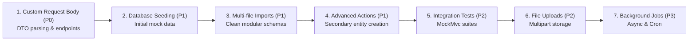

# 🗺️ Zenith DSL — Feature Roadmap & Architecture Guide

This document outlines the strategic roadmap for missing features in Zenith DSL, evaluated by **Priority**, **Implementation Difficulty**, and **Integration Complexity**.

---

## 📊 Feature Prioritization Matrix

| # | Feature | Priority | Implementation Difficulty | Integration Complexity | Target Milestone |
| :- | :--- | :---: | :---: | :---: | :---: |
| **1** | **Custom Request Bodies on Endpoints** | **P0 (Critical)** | 🟢 Low (2-3 days) | 🟢 Low | v1.1 |
| **2** | **Database Seeding (`seed { ... }`)** | **P1 (High)** | 🟢 Low (1-2 days) | 🟢 Low | v1.1 |
| **3** | **Multi-File Modular Schemas (`import`)** | **P1 (High)** | 🟡 Moderate (3-4 days) | 🟡 Moderate | v1.2 |
| **4** | **Advanced Action Logic & Events** | **P1 (High)** | 🔴 High (1-2 weeks) | 🟡 Moderate | v1.2 |
| **5** | **File Uploads & Object Storage** | **P2 (Medium)** | 🟡 Moderate (3-5 days) | 🟡 Moderate | v1.3 |
| **6** | **Automated Integration Test Generator** | **P2 (Medium)** | 🟡 Moderate (3-5 days) | 🟢 Low | v1.3 |
| **7** | **Background Jobs & Cron (`@cron`, `@async`)** | **P3 (Lower)** | 🔴 High (1 week) | 🔴 High | v1.4 |

---

## 📌 Detailed Breakdown & Technical Specifications

---

### 1. Custom Request Bodies on Custom Endpoints

* **Priority**: **P0 (Critical)** — Essential for real-world APIs (payments, invitations, password resets, transfers).
* **Implementation Difficulty**: **Low** — Reuses existing AST parsing and Record generation mechanisms.
* **Integration Complexity**: **Low** — Plugs directly into `CustomEndpointDef`, `ControllerGenerator`, and `ServiceGenerator`.

#### Problem Statement
Currently, custom endpoints only accept `@PathVariable` parameters (e.g. `post "/{id}/pay"`). If an endpoint needs a complex JSON payload (e.g., `cardToken`, `billingAddress`, `reason`), there is no syntax to declare a request body DTO.

#### Proposed Zenith Syntax
```zenith
dto AssignTaskRequest {
    assigneeId: UUID
    comment: String?
    priority: Priority?
}

model Task {
    // ...
    endpoints {
        post "/{id}/assign" (body: AssignTaskRequest) -> TaskResponse {
            auth: true
            guard: status != TaskStatus.DONE, "Cannot reassign completed tasks"
            action: {
                assigneeId = body.assigneeId
            }
        }
    }
}
```

#### Generated Spring Boot 3 Output
```java
// AssignTaskRequest.java (DTO)
public record AssignTaskRequest(
    @NotNull(message = "assigneeId cannot be null") UUID assigneeId,
    String comment,
    Priority priority
) {}

// TaskController.java
@PostMapping("/{id}/assign")
public ResponseEntity<TaskResponse> assign(
    @PathVariable UUID id,
    @Valid @RequestBody AssignTaskRequest body
) {
    return ResponseEntity.ok(service.assign(id, body));
}
```

---

### 2. Declarative Database Seeding (`seed { ... }`)

* **Priority**: **P1 (High)** — Critical for developer experience, local testing, and QA environments.
* **Implementation Difficulty**: **Low** — Straightforward SQL generation or Spring `ApplicationRunner`.
* **Integration Complexity**: **Low** — Generated directly into Flyway `R__seed_data.sql` (repeatable migration) or `DataInitializer.java`.

#### Problem Statement
When running local development with H2 or PostgreSQL, databases start completely empty. Developers must manually write SQL or call `/register` and POST APIs to populate initial users, roles, categories, or projects.

#### Proposed Zenith Syntax
```zenith
seed UserEntity {
    [
        { email: "admin@taskpulse.io", role: ADMIN, fullName: "System Admin" },
        { email: "manager@taskpulse.io", role: MANAGER, fullName: "Team Manager" },
        { email: "dev@taskpulse.io", role: DEVELOPER, fullName: "Core Developer" }
    ]
}

seed Project {
    [
        { name: "Website Redesign", key: "WEB", description: "Main landing page" }
    ]
}
```

#### Generated Spring Boot 3 Output
A Spring Boot `@Component` `DatabaseSeeder.java` with `@Profile("!prod")` using existing Repositories and `PasswordEncoder`:
```java
@Component
@Profile("!prod")
@RequiredArgsConstructor
public class DatabaseSeeder implements ApplicationRunner {
    private final UserEntityRepository userRepository;
    private final PasswordEncoder passwordEncoder;

    @Override
    public void run(ApplicationArguments args) {
        if (userRepository.count() == 0) {
            UserEntity admin = new UserEntity();
            admin.setEmail("admin@taskpulse.io");
            admin.setPassword(passwordEncoder.encode("Admin@123"));
            admin.setRole(Role.ADMIN);
            userRepository.save(admin);
        }
    }
}
```

---

### 3. Multi-File / Modular Schemas (`import`)

* **Priority**: **P1 (High)** — Real-world microservices and backends exceed 500-1,000 lines of schema.
* **Implementation Difficulty**: **Moderate** — Requires cyclic dependency detection and path resolution in the parser.
* **Integration Complexity**: **Moderate** — Modifies `Lexer` & `Parser` entry points to merge AST nodes into one `ZenithFile`.

#### Problem Statement
All models, enums, and configs must currently live in a single `schema.zen`. As applications grow to dozens of models, the file becomes difficult to navigate and maintain in Git teams.

#### Proposed Zenith Syntax
```
api-schema/
├── config.zen
├── auth.zen
├── project.zen
└── task.zen
```
```zenith
// main.zen
import "./config.zen"
import "./auth.zen"
import "./project.zen"
import "./task.zen"
```

#### Architecture Changes
- `Parser.java`: Resolves imported file paths recursively.
- `SemanticAnalyzer.java`: Merges models, validates cross-file relation references (e.g. `Task` referencing `UserEntity` from `auth.zen`), and detects import cycles.

---

### 4. Advanced Action Logic & Domain Operations

* **Priority**: **P1 (High)** — Transforms Zenith from a CRUD generator into a complete business logic framework.
* **Implementation Difficulty**: **High** — Requires expression transpiler for complex mutations, service method invocations, and entity instantiations.
* **Integration Complexity**: **Moderate** — Updates `LogicTranspiler.java` and `ServiceGenerator.java`.

#### Problem Statement
Currently, `action: { ... }` only assigns simple fields on the primary entity (`status = TaskStatus.DONE`). It cannot instantiate secondary entities (like creating an `AuditLog` entry when a task is completed), invoke notifications, or call other repositories.

#### Proposed Zenith Syntax
```zenith
post "/{id}/complete" -> Void {
    auth: true
    guard: status == TaskStatus.IN_PROGRESS, "Task must be in progress"
    action: {
        status = TaskStatus.DONE
        // 1. Audit trail logging
        create AuditLog {
            action = "TASK_COMPLETED",
            details = "Task " + entity.title + " completed by " + currentUser.email
        }
        // 2. Event / Notification hook
        notify(entity.project.owner, "Task completed: " + entity.title)
    }
}
```

#### Generated Spring Boot 3 Output
```java
// Inside TaskServiceImpl.java
entity.setStatus(TaskStatus.DONE);
entity = repository.save(entity);

AuditLog auditLog = new AuditLog();
auditLog.setAction("TASK_COMPLETED");
auditLog.setDetails("Task " + entity.getTitle() + " completed by " + currentUsername);
auditLogRepository.save(auditLog);
```

---

### 5. File Uploads & Media Storage (`@file`, `@image`)

* **Priority**: **P2 (Medium)** — Standard for avatars, attachments, PDFs, and invoices.
* **Implementation Difficulty**: **Moderate** — Requires multipart handling and storage service abstractions.
* **Integration Complexity**: **Moderate** — Generates `StorageService.java`, local disk storage provider, and Multipart form endpoints.

#### Proposed Zenith Syntax
```zenith
model UserEntity {
    // ...
    avatar: String? @file(maxSize = "5MB", types = ["image/png", "image/jpeg"])
}

model Task {
    // ...
    endpoints {
        post "/{id}/attachments" (file: MultipartFile) -> String {
            auth: true
        }
    }
}
```

#### Generated Spring Boot 3 Output
- Generates a pluggable `StorageService` interface (Local disk for dev, AWS S3 / GCS for prod).
- Auto-generates multipart upload controllers:
  ```java
  @PostMapping(value = "/{id}/attachments", consumes = MediaType.MULTIPART_FORM_DATA_VALUE)
  public ResponseEntity<String> uploadAttachment(
      @PathVariable UUID id,
      @RequestParam("file") MultipartFile file
  ) { ... }
  ```

---

### 6. Automated Unit & Integration Tests Generation

* **Priority**: **P2 (Medium)** — Eliminates the final repetitive chore for enterprise Java teams.
* **Implementation Difficulty**: **Moderate** — Standardized template code using Spring Boot Test.
* **Integration Complexity**: **Low** — Generates isolated files inside `src/test/java/...`.

#### Problem Statement
Developers still need to manually write MockMvc and JUnit 5 tests to verify authentication headers, 403 Forbidden checks, and CRUD contract tests.

#### Proposed Zenith Capability
Zenith automatically emits test classes in `src/test/java/com/app/`:
- `*ControllerTest.java` with `@SpringBootTest` & `MockMvc`:
  - Asserts `POST /api/projects` without token returns `401 Unauthorized`.
  - Asserts non-admin calling `@PreAuthorize("hasRole('ADMIN')")` returns `403 Forbidden`.
  - Asserts valid payload creates record and returns `201 Created`.
  - Asserts guard violations return `400 Bad Request`.

---

### 7. Background Workers & Scheduled Jobs (`@cron`, `@async`)

* **Priority**: **P3 (Lower / Specialized)** — Only required for batch jobs, cleanup routines, or asynchronous queues.
* **Implementation Difficulty**: **High** — Requires Spring scheduling / async infrastructure.
* **Integration Complexity**: **High** — Needs thread pool configuration and lock mechanisms (ShedLock).

#### Proposed Zenith Syntax
```zenith
job ArchiveOldTasks {
    cron: "0 0 2 * * ?" // Every day at 2:00 AM
    action: {
        update Task set status = ARCHIVED where status == DONE and updatedAt < daysAgo(30)
    }
}
```

---

## 🚀 Recommended Implementation Sequence



